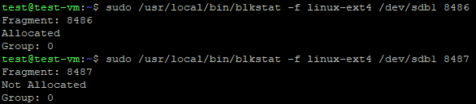

# Lab 5 - Ext4 File Systems — Block Allocation Inspection

## Overview

In this lab, you will explore ext4 block allocation by inspecting the block bitmap on your virtual disk partition. Your goal is to find two adjacent blocks—block $N$ and block $N+1$—where block $N$ is allocated and block $N+1$ is unallocated.

## Assumption

This lab assumes that you have an ext4 file system environment in a Linux system.

## Specification

Use the provided `blkstat` tool to check the allocation status of individual blocks on your ext4 file system. You must identify an integer block number $N$ such that:
1. Block $N$ is **Allocated**
2. Block $N+1$ is **Not Allocated**

## Submission

Submit a single screenshot on Submitty demonstrating your results. Your screenshot must clearly show:

* Block $N$ is allocated.
* Block $N+1$ is unallocated.
* The two blocks are adjacent to each other.

### Example Screenshot

If you have no idea how to identify such blocks, refer to the ext4 lab exercises we did in lecture.

---

**Due Date:** November 9, 2026, at 11:59 PM.  
**Grading:** Each lab is worth a maximum of 5 points. Late submissions will be accepted within 3 days after the deadline, with a 1-point penalty applied to the earned grade.
